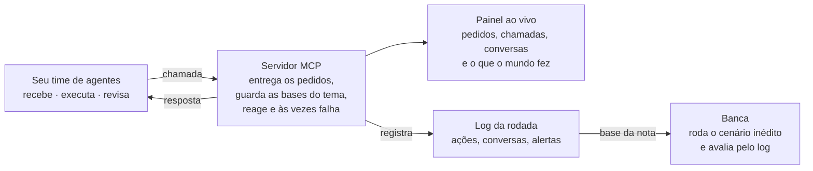

# Hackathon UNIFEI 2026 - Desafios Técnicos

No dia 14/11/2026, um sábado, times de alunos da UNIFEI têm 7 horas para construir um time de colaboradores digitais. São agentes de IA que trabalham como colegas: cada um tem um papel, e eles conversam entre si para dividir as tarefas, revisar o trabalho um do outro e chegar a um resultado melhor do que um agente sozinho chegaria. Cada time escolhe um tema, roda o kit no próprio notebook e, no fim, mostra seus agentes resolvendo um cenário que só a banca conhece.

## Prazo e entrega

- **Quando:** 14/11/2026, na UNIFEI, com 7 horas de evento. Horário e sala: A definir.
- **Kits publicados até:** A definir.
- **Como entregar:** o link do repositório do time, aberto para a banca, até o código congelar. O que entregar está em [Regras e entrega](#regras-e-entrega).
- **Dúvidas:** A definir.

## O que é um colaborador digital

É um agente de IA que trabalha num time como um colega: recebe um pedido, entende o que é, decide o que fazer, age usando ferramentas e registra por que fez cada coisa.

O que separa um bom colaborador digital de um chatbot é saber o limite de cada ação. Em todos os temas, cada ação do seu agente cai num destes três níveis:

| Nível | O que o agente faz | Exemplo |
| --- | --- | --- |
| Faz sozinho | Executa e registra o motivo | Responder uma dúvida que está no FAQ |
| Propõe | Registra uma proposta e só executa depois do OK de uma pessoa | Cancelar um pedido duplicado |
| Só escala | Não age: passa para uma pessoa, com o contexto pronto | Suspeita de incidente de segurança |

O servidor recusa as ações que precisam de uma proposta aprovada; o resto o time decide pelas regras de cada tema. Agir sozinho no que devia ser proposto ou escalado conta como erro, mesmo que o resultado pareça certo.

### Um time, não um agente

A proposta do hackathon é montar os agentes como uma equipe de verdade. Cada agente tem um papel, sabe o que os outros fazem e chama um colega quando o caso sai da sua área.

- **Dividir:** um agente recebe o pedido e passa para quem entende do assunto.
- **Revisar:** antes de uma ação importante, outro agente confere e pode devolver com uma objeção.
- **Melhorar:** o que um agente erra, outro aponta, e o time corrige antes de agir.

Duas regras valem para todos os temas:

- Toda conversa entre agentes fica registrada no log, do jeito que o time escolher, para a banca ver quem disse o quê a quem.
- Uma proposta só é aprovada por uma pessoa. Outro agente pode revisar e recomendar, mas não substitui o OK humano.

**Para assistir antes:** [Stanford CS146S: How always-on agents work](https://youtu.be/L1OBRtfPS34), por leerob.

## Como funciona o kit

Todo tema vem com as mesmas peças; muda só o conteúdo.



O [servidor MCP do hackathon](Servidor%20MCP%20%28Compartilhado%29/) é o mundo: ele entrega os pedidos ao longo do dia, guarda as bases de dados de cada tema e reage ao que os agentes fazem. O time cuida só dos agentes. Tudo o que acontece aparece ao vivo num painel no navegador.

De vez em quando o servidor falha de propósito, como um sistema de verdade: tratar o erro faz parte do desafio. Toda chamada leva o nome do agente, e toda ação leva também o motivo. Como os agentes conversam entre si é escolha do time, mas as conversas precisam aparecer no log. No fim do dia, a banca sobe o mesmo servidor com o cenário inédito, roda os agentes de cada time e avalia pelo log.

## Antes de chegar

Traga o notebook com o kit já rodando: a primeira meia hora do dia não é para instalar nada.

1. **Crie uma conta no GitHub**, se ainda não tiver.
2. **Instale** Git, Python 3.11 ou mais novo e um editor de código. O servidor MCP do kit é em Python; os seus agentes podem ser na linguagem que o time quiser.
3. **Baixe os desafios:**

   ```bash
   git clone https://github.com/tech4humans-brasil/t4h-desafios.git
   ```

   Tudo do evento fica nesta pasta, `Hackathon - UNIFEI 2026`, com uma subpasta por tema.
4. **Suba o mundo e rode o agente de exemplo**, seguindo o [README do servidor](Servidor%20MCP%20%28Compartilhado%29/). Se as chamadas dele aparecerem no painel, está tudo certo.

**Crédito de IA.** Cada time recebe no dia uma chave de API com crédito para o modelo de IA oferecido pela T4H. A chave fica num arquivo `.env` fora do Git: nunca a coloque no código nem no repositório.

## Regras e entrega

Cada time escolhe um tema e entrega, até o código congelar, um time de agentes que roda sozinho do começo ao fim do cenário.

**Times.** De 4 a 5 pessoas. A escolha do tema é feita na abertura.

**O que pode**

- Qualquer linguagem, framework de agente, biblioteca e assistente de código.
- Qualquer modelo de IA; o crédito garantido é o que entregamos no dia.
- Criar dados extras de teste a partir dos do kit.

**O que não pode**

- Usar dados reais de pessoas ou empresas. Tudo no kit é fictício, e deve continuar assim.
- Alterar o servidor MCP do kit.
- Escrever no código a resposta de cada pedido do treino. O cenário da banca tem pedidos novos, e o agente que só decorou o treino erra todos.
- Alguém do time intervir enquanto os agentes rodam. Pessoa só entra quando um agente propõe ou escala, e quem responde é o servidor MCP.

**O que entregar**

1. O link do repositório do time, aberto para a banca.
2. Um `README.md` que explica como rodar os agentes com um comando e qual é o papel de cada um.
3. Um motivo em toda ação: cada chamada ao servidor MCP leva o campo `motivo` e o nome do agente que agiu; as conversas entre os agentes também entram no log de decisões.
4. Demo ao vivo e pitch de 5 minutos: como os agentes dividem o trabalho, um caso em que um agente corrigiu outro, um caso em que o time chamou uma pessoa e o que o time faria com mais tempo.

## Como avaliamos

O critério que mais pesa é o cenário inédito, que a banca roda com o agente congelado de cada time. Os critérios são os mesmos para todos os temas.

| Critério | Peso | O que olhamos |
| --- | --- | --- |
| Cenário inédito | 35% | Quantos pedidos do cenário da banca receberam a ação certa, conferido no log |
| Time de agentes | 20% | Os papéis fazem sentido, os agentes conversam para dividir e revisar o trabalho, e dá para ver no log uma revisão que mudou o resultado para melhor |
| Limites | 20% | Chamou uma pessoa quando devia, propôs em vez de executar quando a regra pede não tomou sozinho nenhuma decisão que não era dele e reagiu bem quando uma ferramenta falhou |
| Explicação | 10% | Os motivos e as conversas do log são claros e batem com a ação tomada |
| Demo e pitch | 15% | O time mostra os agentes funcionando e explica como eles dividem o trabalho |

Cada tema tem **erros graves** que descontam pontos além de zerar o pedido, como ignorar um incidente de verdade. Eles estão listados no README do tema. O cenário de treino não entra na nota: ele serve para o time testar os agentes antes. Desempate: menos erros graves.

## Estrutura

```
Hackathon - UNIFEI 2026/
├── README.md                                  # este arquivo: regras e visão geral
├── Servidor MCP (Compartilhado)/              # o servidor usado nos três temas
│   ├── README.md
│   ├── mundo.py                               # sobe o servidor MCP e o painel
│   ├── agente_exemplo.py                      # agente que funciona, só que mal
│   ├── ver_log.py
│   ├── requirements.txt
│   ├── hackathon/                             # o motor e as ferramentas de cada tema
│   └── dados/                                 # as bases fictícias de cada tema
├── Triagem N1 (Chamados e incidentes)/
│   └── README.md                              # enunciado do Tema 1
└── Gestão de equipamentos (Parque de TI)/
    └── README.md                              # enunciado do Tema 3
```

Os dados de cada tema ficam dentro do servidor, em `dados/`. Nada disso é real.

## Os temas

Dois temas estão prontos para escolha (1 e 3); o 2 está em preparação com o time de Pessoas.

| Tema | O que o time de agentes faz | O que chega para ele | Situação |
| --- | --- | --- | --- |
| [1 — Triagem N1 de chamados e incidentes](Triagem%20N1%20%28Chamados%20e%20incidentes%29/) | O primeiro atendimento dos pedidos internos: entende, responde, encaminha e separa o incidente de verdade | E-mails de colegas pedindo acesso, equipamento, suporte, ou avisando que algo caiu | Pronto |
| 2 — Admissão de novo colaborador | Conduz a entrada de uma pessoa nova até o primeiro dia, cobrando cada etapa | Pessoas aprovadas, documentos e respostas das áreas envolvidas | Em preparação |
| [3 — Gestão de equipamentos](Gest%C3%A3o%20de%20equipamentos%20%28Parque%20de%20TI%29/) | Cuida do parque de notebooks, monitores e periféricos: atende, aloca, compra e cobra devolução | Pedidos de equipamento e uma planilha de inventário com erros | Pronto |

### [Servidor MCP (Compartilhado)](Servidor%20MCP%20%28Compartilhado%29/)

O mundo onde os agentes agem, com o painel ao vivo:

- `README.md`: como subir o mundo, conectar os agentes e ler o log
- `mundo.py`: sobe o servidor MCP e o painel ao vivo do tema escolhido
- `agente_exemplo.py`: um agente sem IA que escala tudo, para mostrar como conectar
- `ver_log.py`: resume o log de uma rodada
- `hackathon/`: o motor do mundo e as ferramentas de cada tema
- `dados/triagem/` e `dados/equipamentos/`: as bases fictícias de cada tema

### 1. [Triagem N1 (Chamados e incidentes)](Triagem%20N1%20%28Chamados%20e%20incidentes%29/)

Um time de agentes lê cada pedido interno que chega por e-mail, decide a ação certa e deixa para uma pessoa só o que é dela:

- `README.md`: enunciado completo, com o kit, os tipos de chamado, a criticidade, as ações e os erros graves

### 2. Admissão de novo colaborador (em preparação)

Três pessoas começam na T4H daqui a 10 dias. Até lá precisam entregar os documentos, receber o notebook e ter os acessos criados, e o gestor precisa estar avisado. Um time de agentes toma conta disso, cada um cuidando de uma parte (documentos, áreas envolvidas, calendário), e só chama uma pessoa quando precisa de uma decisão, como mudar a data de início. O enunciado completo entra aqui quando estiver pronto.

### 3. [Gestão de equipamentos (Parque de TI)](Gest%C3%A3o%20de%20equipamentos%20%28Parque%20de%20TI%29/)

Um time de agentes cuida do parque de equipamentos: atende pedidos, mantém o inventário certo, prepara o kit de quem entra e cobra a devolução de quem sai:

- `README.md`: enunciado completo, com o kit, o inventário, as regras, as ações e os erros graves

## Como Utilizar

1. Leia este README inteiro: as regras e a avaliação valem para todos os temas
2. Escolha um tema e leia o `README.md` da pasta dele
3. Antes do evento, suba o servidor MCP e rode o agente de exemplo do tema no seu notebook
4. No dia, construa o time de agentes e teste no cenário de treino
5. Entregue o link do repositório do time até o código congelar

## Observações Importantes

- Todos os dados dos kits são fictícios. Não use dados reais de pessoas ou empresas
- Nunca commite a chave de API nem o arquivo `.env`
- O cenário inédito só existe com a banca: decorar o treino não ajuda
- Em caso de dúvidas, use o canal indicado em [Prazo e entrega](#prazo-e-entrega)

Boa sorte no hackathon!
