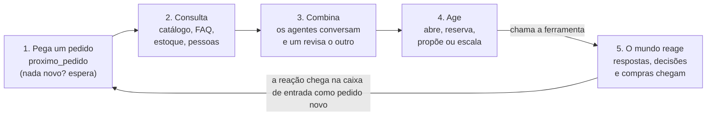

# Servidor MCP

O servidor MCP é a empresa simulada de cada tema. Os agentes de vocês se conectam a ele, pegam os pedidos e agem pelas ferramentas que ele oferece. Ele guarda os dados, reage ao que os agentes fazem e mostra tudo num painel no navegador. É o mesmo para todos os temas.

Tudo aqui é fictício: pessoas, e-mails, produtos e equipamentos.

## O que é MCP

MCP (Model Context Protocol) é um padrão aberto para agentes de IA usarem ferramentas. Um servidor MCP publica uma lista de ferramentas, cada uma com nome, descrição e parâmetros. O agente lê essa lista, escolhe a ferramenta certa e a chama, como um programa chamaria uma função. Os principais clientes e frameworks de agentes já falam MCP, então o time não precisa escrever integração nenhuma: basta apontar o agente para o endereço do servidor.

## Quem chama quem

O servidor nunca chama o agente. É o agente que chama o servidor, o tempo todo, como alguém que confere a caixa de entrada.



O passo 5 é o que deixa o mundo vivo: quando o agente pede uma informação, propõe uma compra ou cobra uma devolução, a resposta não vem na hora. Ela chega minutos depois, no relógio simulado, como um pedido novo na mesma caixa (com id do tipo `PED-017-R1` ou `MSG-003`), e o ciclo recomeça.

## O relógio

- O expediente é simulado: vai das 08:00 às 18:00, só em dias úteis. No Tema 1, 5 dias passam em 20 minutos; no Tema 3, 22 dias passam em 22 minutos.
- O relógio começa na primeira chamada de qualquer agente. Antes disso, o mundo fica parado esperando.
- Os pedidos chegam na hora marcada do cenário, não todos de uma vez. Toda resposta traz a hora simulada no campo `agora`.

## As ferramentas

A lista completa, com os parâmetros de cada uma, vem do próprio servidor quando o agente se conecta. Em resumo:

**Em todos os temas**

| Ferramenta | Para quê |
| --- | --- |
| `proximo_pedido` | Pega o próximo pedido novo da caixa de entrada |
| `listar_pedidos`, `ler_pedido` | Vê a caixa de entrada e o que já foi feito em cada pedido |
| `responder_pedido` | Responde a quem pediu |
| `escalar` | Passa o caso para uma pessoa, com um resumo |
| `propor`, `consultar_proposta` | Pede o OK de uma pessoa e acompanha a decisão |
| `registrar_conversa` | Deixa no log uma conversa entre dois agentes do time |

**Tema 1 — Triagem N1**

| Ferramenta | Para quê |
| --- | --- |
| `consultar_faq`, `consultar_catalogo`, `listar_times`, `buscar_chamados` | Consultas: respostas prontas, tipos de chamado, times e chamados que já existem |
| `abrir_chamado` | Abre um chamado do catálogo; recusa se faltar campo obrigatório |
| `pedir_informacao` | Pede a quem enviou o que falta; a resposta chega depois na caixa |
| `juntar_duplicado`, `encaminhar` | Liga a um chamado que já existe ou manda ao time certo |
| `abrir_incidente` | Abre um incidente P0, P1 ou P2 |
| `cancelar_chamado`, `trocar_aprovador` | Só com uma proposta aprovada |

**Tema 3 — Equipamentos**

| Ferramenta | Para quê |
| --- | --- |
| `consultar_estoque`, `buscar_itens`, `consultar_colaborador`, `consultar_catalogo_compra`, `consultar_regras` | Consultas: estoque, inventário, pessoas, preços e regras |
| `reservar`, `alocar` | Separa e entrega um item; recusa se o item já estiver com alguém |
| `cobrar_devolucao`, `registrar_devolucao` | Cobra quem está com o item e registra quando ele volta |
| `abrir_compra` | Compra itens; acima de R$ 500, só com uma proposta aprovada |
| `corrigir_inventario`, `baixar` | Só com uma proposta aprovada |

## Regras de toda chamada

- Toda chamada leva o campo `agente`, com o nome do agente do time que está agindo.
- Toda ação, ou seja, tudo o que muda o mundo, leva também o campo `motivo`.
- Ações que precisam do OK de uma pessoa pedem o id de uma proposta aprovada: primeiro o agente chama `propor`, e a decisão chega depois na caixa de entrada.
- A resposta é sempre um JSON com `status` (`ok` ou `erro`) e `agora`. Quando o pedido do agente está errado, o erro diz o motivo: 400 (faltou campo), 403 (precisa de proposta), 404 (não existe), 409 (o item mudou ou já está com alguém), 410 (cenário encerrado) ou 422 (valor inválido).

## Como rodar

Com Docker é o jeito mais simples: não precisa instalar Python. Dentro desta pasta:

```bash
TEMA=triagem docker compose up mundo
```

Para o Tema 3, troque por `TEMA=equipamentos`. No Windows (PowerShell), rode antes `$env:TEMA="triagem"` e depois `docker compose up mundo`.

Sem Docker, com Python 3.11 ou mais novo:

```bash
python -m venv .venv
source .venv/bin/activate        # no Windows: .venv\Scripts\activate
pip install -r requirements.txt
python mundo.py --tema triagem
```

Com o servidor no ar:

| O quê | Endereço |
| --- | --- |
| Painel ao vivo | `http://localhost:8765` |
| Servidor MCP | `http://localhost:8765/mcp` |

Para conferir se está tudo certo, rode o agente de exemplo num segundo terminal: `docker compose run --rm --no-deps exemplo` ou `python agente_exemplo.py`. Ele escala tudo para uma pessoa e não usa IA. Funciona, só que mal.

## Como conectar o seu agente

Qualquer cliente MCP que fale Streamable HTTP funciona. Dois exemplos:

```python
from mcp import Client

async with Client("http://localhost:8765/mcp") as cliente:
    ferramentas = await cliente.list_tools()
    pedido = await cliente.call_tool("proximo_pedido", {"agente": "triador"})
```

```bash
claude mcp add --transport http hackathon http://localhost:8765/mcp
```

Todos os agentes do time apontam para o mesmo servidor e veem o mesmo mundo. O [`agente_exemplo.py`](agente_exemplo.py) mostra o laço completo em poucas linhas: conectar, pegar pedido, agir e tratar as falhas.

## As falhas

Por padrão, 15% das chamadas falham ou demoram de propósito, como num sistema de verdade. Tratar isso faz parte do desafio.

| Falha | O que o agente precisa fazer |
| --- | --- |
| Erro 503 | Tentar de novo depois de alguns segundos |
| Resposta lenta | Esperar: a resposta chega certa, só que demora |
| Erro 504 | Conferir antes de repetir, porque a ação pode ter sido feita ou não |
| Erro 409 | Consultar de novo antes de agir |

## O painel e o log

- **Painel** (`http://localhost:8765`): a caixa de entrada com o status de cada pedido, as chamadas e conversas dos agentes ao vivo e o que o mundo fez, com alertas quando algo dá errado.
- **Log**: cada rodada grava tudo em `logs/<tema>-<data>.jsonl`. Para ler o mais recente: `python ver_log.py`.

## Opções úteis

| Opção | Para quê |
| --- | --- |
| `--erros 0` | Desliga as falhas, para testar a lógica primeiro |
| `--segundos-por-dia 60` | Acelera ou desacelera o relógio |
| `--seed 42` | Repete os mesmos sorteios a cada rodada |
| `--porta 9000` | Muda a porta |

No Docker, as opções vão depois do nome do serviço: `docker compose run --rm --service-ports mundo --tema triagem --erros 0`.
