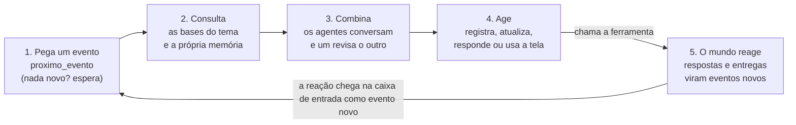

# Servidor MCP

Simula uma empresa fictícia para os agentes trabalharem. Entrega eventos ao longo de um expediente simulado, guarda as bases de dados do tema, valida o que os agentes registram, reage ao que eles fazem e mostra tudo num painel ao vivo. O mesmo servidor atende todos os temas.

## Como rodar

Com Docker, dentro desta pasta:

```bash
TEMA=triagem docker compose up mundo
```

Para o Tema 3, use `TEMA=equipamentos`. No Windows (PowerShell), rode antes `$env:TEMA="triagem"` e depois `docker compose up mundo`.

Sem Docker, com Python 3.11 ou mais novo:

```bash
python -m venv .venv
source .venv/bin/activate        # no Windows: .venv\Scripts\activate
pip install -r requirements.txt
python mundo.py --tema triagem
```

Com o servidor no ar:

| O quê | Endereço |
| --- | --- |
| Painel ao vivo | `http://localhost:8765` |
| Servidor MCP (Streamable HTTP) | `http://localhost:8765/mcp` |
| Sistemas só com tela | `http://localhost:8765/legado` |

Para testar, rode o agente de exemplo num segundo terminal: `docker compose run --rm --no-deps exemplo` ou `python agente_exemplo.py`. Ele pega cada evento e só responde que recebeu.

## Quem chama quem

O servidor nunca chama o agente. O agente chama o servidor, o tempo todo:



As reações não vêm na hora: chegam minutos depois, no relógio simulado, como eventos novos na mesma caixa (ids do tipo `PED-017-R1` ou `MSG-003`).

## Os eventos

- Chegam sozinhos, na hora marcada do cenário de treino (`dados/<tema>/treino.json`).
- Também podem ser criados por uma pessoa no painel, pelo botão **+ Novo evento** (ids `MAN-...`). Com `--sem-cenario`, só chegam os do painel.
- Cada evento tem `origem`: `cenario`, `painel` ou `mundo` (resposta de alguém).

## O relógio

- O expediente é simulado, das 08:00 às 18:00, só em dias úteis. Por padrão, 5 dias em 20 minutos no Tema 1 e 22 dias em 22 minutos no Tema 3 (`--segundos-por-dia` muda isso).
- O relógio começa na primeira chamada de qualquer agente.
- Toda resposta traz a hora simulada em `agora`.

## As ferramentas

São as mesmas em todos os temas. As bases de cada tema aparecem com `listar_bases`.

| Ferramenta | O que faz |
| --- | --- |
| `proximo_evento` | Pega o próximo evento novo e marca como lido |
| `listar_eventos`, `ler_evento` | Lista os eventos (filtro por status) e lê um evento com o que já foi feito nele |
| `responder_evento` | Responde a quem mandou; com `aguardar_resposta: true`, a pessoa pode responder de volta |
| `enviar_mensagem` | Manda uma mensagem para qualquer pessoa ou time do mundo, pelo e-mail |
| `listar_bases` | Lista as bases: descrição, campos, chave, se aceita registro novo e quais campos podem ser alterados |
| `consultar` | Busca numa base: `filtro` compara campo a campo (contém, sem acento) e `busca` procura palavras em qualquer campo |
| `registrar` | Cria um registro numa base que aceite; o mundo valida as regras do tema |
| `atualizar` | Altera campos de um registro pela chave; o mundo valida as regras do tema |
| `registrar_conversa` | Deixa no painel e no log uma conversa entre dois agentes |

Todas recebem `agente` (obrigatório: é assim que o painel mostra quem chamou cada ferramenta) e `motivo` (opcional, aparece no painel). `registrar`, `atualizar` e `enviar_mensagem` aceitam `evento_id` para ligar a ação a um evento.

Memória, escalação e aprovação não existem no servidor: ficam com os times.

A resposta é sempre um JSON com `status` (`ok` ou `erro`) e `agora`. Erros de regra: 400 (faltou campo), 404 (não existe), 405 (a base não aceita isso), 409 (o item mudou ou já está com alguém) e 422 (valor inválido ou regra do tema).

## Sistemas só com tela

Alguns sistemas não têm API: só uma tela HTML em `/legado`. Para usá-los, o agente precisa operar a tela (computer use ou automação de navegador). Cada formulário pede o nome do agente, e o que for feito pela tela aparece no painel e no log com `via: "tela"`. Os sistemas de cada tema estão na ficha técnica do tema.

## As falhas

Por padrão, 15% das chamadas MCP falham ou demoram de propósito (`--erros` muda a chance):

| Falha | O que acontece |
| --- | --- |
| Erro 503 | Indisponível; tentar de novo costuma resolver |
| Lenta | Responde certo depois de alguns segundos |
| Erro 504 | Demorou demais; a ação pode ou não ter sido feita |
| Erro 409 | Conflito momentâneo; consultar de novo antes de agir |

## O painel e o log

- **Painel** (`http://localhost:8765`): caixa de entrada com status e origem de cada evento, chamadas e conversas ao vivo com filtro por agente, quem está chamando o quê, indicadores e alertas do mundo, e o botão **+ Novo evento**.
- **Log**: cada rodada grava tudo em `logs/<tema>-<data>.jsonl`. Para resumir o mais recente: `python ver_log.py` (ou `--agente <nome>`, `--erros`).

## Opções

| Opção | Para quê |
| --- | --- |
| `--tema triagem` ou `--tema equipamentos` | Escolhe o tema |
| `--erros 0` | Desliga as falhas simuladas (padrão `0.15`) |
| `--sem-cenario` | Só chegam os eventos criados no painel |
| `--segundos-por-dia 60` | Muda a velocidade do relógio |
| `--seed 42` | Repete os mesmos sorteios a cada rodada |
| `--porta 9000` | Muda a porta |
| `--cenario arquivo.json`, `--dados pasta/` | Usa outro cenário ou outras bases |
| `--sem-navegador` | Não abre o painel sozinho |

No Docker, as opções vão depois do nome do serviço: `docker compose run --rm --service-ports mundo --tema triagem --erros 0`.
