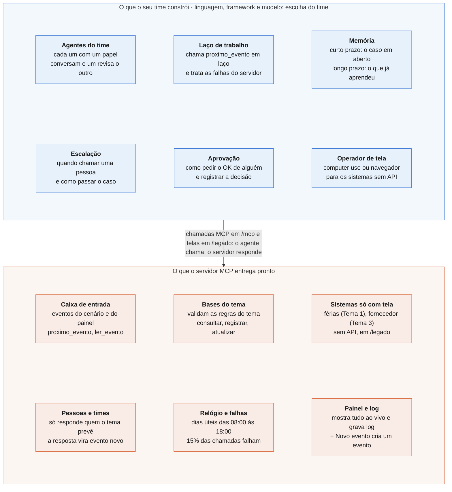

# Servidor MCP

Simula uma empresa fictícia para os agentes trabalharem. Entrega eventos ao longo de um expediente simulado, guarda as bases de dados do tema, valida o que os agentes registram, reage ao que eles fazem e mostra tudo num painel ao vivo. O mesmo servidor atende todos os temas.

## Como rodar

Com Docker, dentro desta pasta:

```bash
TEMA=triagem docker compose up --build mundo
```

Para o Tema 3, use `TEMA=equipamentos`. Para parar, `Ctrl+C` (ou `docker compose down` em outro terminal).

No Windows, defina a variável antes: no PowerShell, `$env:TEMA="triagem"`; no Prompt de Comando, `set TEMA=triagem`. Depois rode `docker compose up --build mundo`.

Sem Docker, com Python 3.11 ou mais novo (confira com `python3 --version`; o Python que vem no macOS costuma ser 3.9):

```bash
python3 -m venv .venv
source .venv/bin/activate        # no Windows: .venv\Scripts\activate
pip install -r requirements.txt
python mundo.py --tema triagem
```

Use um ambiente virtual só para o servidor, separado do ambiente do seu agente: o servidor usa o SDK `mcp` 2.x, e algumas bibliotecas de agentes ainda pedem a 1.x.

Com o servidor no ar:

| O quê | Endereço |
| --- | --- |
| Painel ao vivo | `http://localhost:8765` |
| Servidor MCP (Streamable HTTP) | `http://localhost:8765/mcp` |
| Sistemas só com tela | `http://localhost:8765/legado` |

Sem Docker, o servidor só aceita conexões da própria máquina. Se o agente roda em outro container ou em outra máquina, suba com `--host 0.0.0.0` (no Docker isso já vem ligado).

## Quem chama quem

Vocês constroem o time de agentes; o servidor MCP é o mundo e só responde. Nada no servidor chama o agente: quem puxa é sempre o time.



O agente precisa rodar em laço: chamar `proximo_evento` até a resposta trazer `encerrado: true`. Quando não há evento novo, a resposta traz `evento: null` e a hora em que chega o próximo evento do cenário. Com `esperar_segundos` (até 30), o próprio servidor segura a resposta até chegar um evento.

As reações do mundo não vêm na hora: chegam minutos depois, no relógio simulado, como eventos novos na mesma caixa (ids do tipo `PED-017-R1` ou `MSG-003`, com `responde_a` apontando para o evento original).

## Os eventos

- Chegam sozinhos, na hora marcada do cenário de treino (`dados/<tema>/treino.json`), com alguns minutos de variação.
- Também podem ser criados por uma pessoa no painel, pelo botão **+ Novo evento** (ids `MAN-...`). Com `--sem-cenario`, só chegam os do painel.
- Cada evento tem `origem`: `cenario`, `painel` ou `mundo` (resposta de alguém).
- `status` começa em `novo`, vira `lido` quando um agente pega o evento com `proximo_evento` e `respondido` depois de `responder_evento`. O time pode gravar outro status ou uma `observacao` com `atualizar` na base `eventos`.
- **Conta como atendimento** do evento (aparece em `acoes` e nos indicadores): `responder_evento`, e `enviar_mensagem`, `registrar`, `atualizar` ou uma tela quando recebem o `evento_id`. Mudar só o status do evento não conta.

## O relógio

- O expediente é simulado, das 08:00 às 18:00, só em dias úteis. Por padrão, 5 dias em 40 minutos no Tema 1 e 22 dias em 44 minutos no Tema 3. `--segundos-por-dia` muda isso: mais alto dá mais tempo para o agente pensar.
- O relógio começa na primeira chamada de qualquer agente, por MCP ou por uma tela.
- Toda resposta traz a hora simulada em `agora`.
- Quando o cenário acaba, as consultas continuam funcionando e as ações (`registrar`, `atualizar`, `responder_evento`, `enviar_mensagem`) passam a dar erro 410.
- Reiniciar o servidor começa tudo de novo, do zero. O cliente MCP do agente precisa reconectar.

## As ferramentas

São as mesmas em todos os temas. As bases de cada tema aparecem com `listar_bases`.

| Ferramenta | O que faz |
| --- | --- |
| `proximo_evento` | Pega o próximo evento novo e marca como lido; `esperar_segundos` espera um evento chegar |
| `listar_eventos`, `ler_evento` | Lista os eventos (filtro por status, paginado) e lê um evento com o que já foi feito nele |
| `responder_evento` | Responde a quem mandou; com `aguardar_resposta: true`, a pessoa pode responder de volta |
| `enviar_mensagem` | Manda uma mensagem, pelo e-mail, para um time, para quem mandou um evento ou para alguém das bases do tema |
| `listar_bases` | Lista as bases: descrição, chave, campos, campos para registrar (com exemplo) e campos que podem ser alterados |
| `consultar` | Busca numa base: `filtro` compara campo a campo (contém, sem acento) e `busca` procura palavras em qualquer campo |
| `registrar` | Cria um registro numa base que aceite; o mundo valida as regras do tema |
| `atualizar` | Altera campos de um registro pela chave da base (`id`, `patrimonio`, `tipo`...); o mundo valida as regras do tema |
| `registrar_conversa` | Deixa no painel e no log uma conversa entre dois agentes (não entrega nada a ninguém) |

Regras de toda chamada:

- Todas recebem `agente` (obrigatório: é assim que o painel mostra quem chamou cada ferramenta) e `motivo` (opcional, aparece no painel). `registrar`, `atualizar` e `enviar_mensagem` aceitam `evento_id` para ligar a ação a um evento.
- `consultar` e `listar_eventos` devolvem `total` e `tem_mais`. Use `limite` e `offset` para paginar (`consultar`: padrão 20, no máximo 100).
- A resposta é sempre um JSON com `status` (`ok` ou `erro`) e `agora`. Erros de regra trazem `codigo` e `mensagem`: 400 (faltou campo), 404 (não existe), 405 (a base não aceita isso), 409 (o item mudou ou já está com alguém), 410 (o cenário acabou) e 422 (valor inválido ou regra do tema).
- `enviar_mensagem` para um endereço que não existe no mundo dá 404. Só responde quem o tema prevê: a resposta diz `vai_responder`.
- Algumas falhas demoram até 9 segundos: deixe o timeout do cliente MCP em 15 segundos ou mais.

Memória, escalação e aprovação não existem no servidor: ficam com os times.

## Sistemas só com tela

Alguns sistemas não têm API: só uma tela HTML em `/legado`. Para usá-los, o agente precisa operar a tela (computer use ou automação de navegador). Cada formulário pede o nome do agente, e o que for feito pela tela aparece no painel e no log com `via: "tela"`. Os sistemas de cada tema estão na ficha técnica do tema.

## As falhas

Por padrão, 15% das chamadas MCP falham ou demoram de propósito (`--erros` muda a chance):

| Falha | O que acontece |
| --- | --- |
| Erro 503 | Indisponível; tentar de novo costuma resolver |
| Lenta | Responde certo depois de 2 a 5 segundos |
| Erro 504 | Demorou demais. Numa ação, ela pode ou não ter sido feita: confira antes de repetir. Numa consulta, nada mudou |
| Erro 409 | Conflito momentâneo numa ação; consultar de novo antes de agir. Consultas não sofrem conflito |

`registrar_conversa` e as telas não sofrem falhas simuladas. Um erro 500 é falha de verdade do servidor: avise a organização.

## O painel e o log

- **Painel** (`http://localhost:8765`): caixa de entrada com status e origem de cada evento, chamadas e conversas ao vivo com filtro por agente, quem está chamando o quê, indicadores e alertas do mundo, e o botão **+ Novo evento**.
- **Log**: cada rodada grava tudo em `logs/<tema>-<data>.jsonl`. Para resumir o mais recente: `python ver_log.py` (ou `--agente <nome>`, `--erros`).

## Opções

Toda opção também pode vir de uma variável de ambiente, que é como o Docker as recebe.

| Opção | Variável | Para quê |
| --- | --- | --- |
| `--tema triagem` ou `--tema equipamentos` | `TEMA` | Escolhe o tema |
| `--erros 0` | `ERROS` | Desliga as falhas simuladas (padrão `0.15`) |
| `--sem-cenario` | `SEM_CENARIO=1` | Só chegam os eventos criados no painel |
| `--segundos-por-dia 900` | `SEGUNDOS_POR_DIA` | Muda a velocidade do relógio |
| `--seed 42` | `SEED` | Repete os mesmos sorteios (falhas, horários) a cada rodada, desde que o agente faça as mesmas chamadas |
| `--porta 9000` | `PORTA` | Muda a porta (no Docker, muda a porta do lado de fora) |
| `--host 0.0.0.0` | `HOST` | Aceita conexões de fora da máquina |
| `--cenario arquivo.json`, `--dados pasta/` | `CENARIO`, `DADOS` | Usa outro cenário ou outras bases |
| `--sem-navegador` | `SEM_NAVEGADOR=1` | Não abre o painel sozinho |

Exemplo no Docker: `TEMA=equipamentos ERROS=0 PORTA=9000 docker compose up --build mundo`.

## Cenários próprios

Um cenário é um JSON com `tema`, `nome`, `inicio` (primeiro dia, `AAAA-MM-DD`), `dias` (dias de expediente) e `pedidos`. Cada pedido tem `id`, `dia`, `hora` (`HH:MM`), `de`, `nome`, `assunto` e `corpo`. Copie o `treino.json` do tema e mude o que quiser; suba com `--cenario`.
